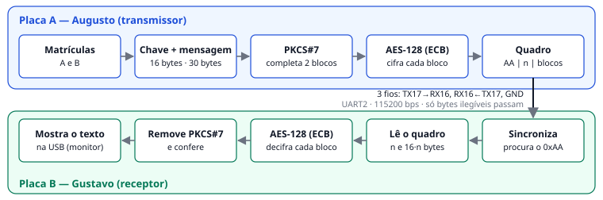
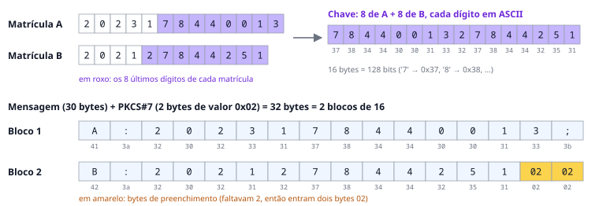
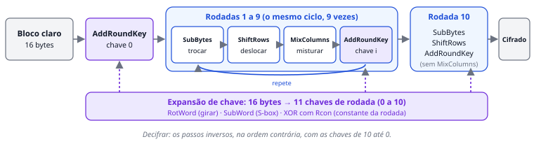
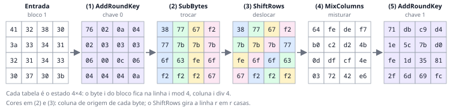
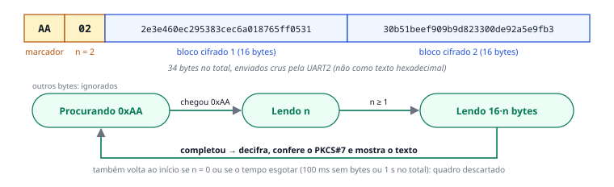
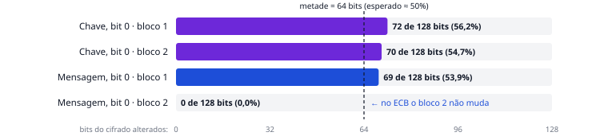
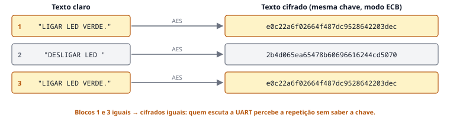

# AES-128 em dois ESP32 via UART

**Dupla:** Augusto (aluno A, matrícula 2023178440013) e Gustavo (aluno B, matrícula 202127844251)  
**Disciplina:** Segurança de Sistemas de Computação · **Ensaios nas placas:** 19/10/2026  
**Código-fonte:** https://github.com/lemonieAug/Atv2EspsAES-

## 1. O que o sistema faz

Duas placas ESP32 conversam por três fios. A placa **A** (transmissor) monta uma mensagem com as matrículas da dupla, embaralha essa mensagem com o algoritmo **AES-128** usando uma chave secreta e envia o resultado pelos fios. A placa **B** (receptor) conhece a mesma chave, desfaz o embaralhamento e mostra a mensagem original no computador. Quem espiar os fios no meio do caminho vê apenas bytes sem sentido.

> **Vocabulário rápido.** **Cifrar** é transformar um texto legível em bytes ilegíveis; **decifrar** é o caminho de volta. A **chave** é o segredo que as duas placas compartilham: no AES-128 ela tem 16 bytes (128 bits). O AES trabalha em **blocos** de 16 bytes, e uma mensagem maior é cortada em vários blocos. É uma cifra **simétrica**: a mesma chave cifra e decifra.

Todo o AES foi escrito do zero em C, sem bibliotecas de criptografia. As placas usam a porta serial UART2 (115200 bps, 8N1): o pino TX (GPIO17) de cada placa vai ao RX (GPIO16) da outra, com o terra (GND) comum. Pela USB, cada placa mostra no computador o que está fazendo.

## 2. Chave e mensagem a partir das matrículas

O enunciado define duas regras. A **chave** usa só os dígitos: os 8 últimos da matrícula de A, seguidos dos 8 últimos da matrícula de B. Cada dígito é guardado como texto, isto é, pelo seu código ASCII ('7' vira o byte 0x37), o que dá exatamente 16 bytes. A **mensagem** é `A:<matrícula A>;B:<matrícula B>`, com as matrículas completas: 30 bytes no nosso caso.

Como o AES só trabalha com blocos inteiros de 16 bytes, a mensagem é completada com o **preenchimento PKCS#7**. Faltam *k* bytes para fechar o bloco, então acrescentamos *k* bytes de valor *k*. Faltavam 2, então entraram dois bytes 0x02. Se a mensagem já tiver tamanho múltiplo de 16, entra um bloco inteiro de 0x10. Assim o receptor sempre sabe quantos bytes remover.

## 3. Como o AES embaralha um bloco

O AES coloca os 16 bytes do bloco numa tabela 4×4, preenchida **coluna por coluna**: os 4 primeiros bytes formam a 1ª coluna, e assim por diante. Essa tabela é o **estado**. A cifra repete 10 **rodadas** sobre o estado, e cada rodada combina quatro passos simples:

- **SubBytes (trocar):** cada byte é trocado por outro, consultando uma tabela fixa chamada S-box. A S-box vem da matemática do corpo GF(2⁸): para cada byte calcula-se o seu inverso multiplicativo e aplica-se uma transformação afim. Nosso código calcula a tabela dessa forma ao ligar. É o passo "não linear", que impede resolver o AES com equações simples.
- **ShiftRows (deslocar):** a linha 0 fica parada, a linha 1 gira 1 casa para a esquerda, a linha 2 gira 2 e a linha 3 gira 3. Os bytes de uma coluna se espalham por colunas diferentes.
- **MixColumns (misturar):** cada coluna é multiplicada por uma matriz fixa, e cada byte de saída passa a depender dos 4 bytes da coluna. A multiplicação usa a operação `xtime`: multiplicar por 2 é deslocar os bits uma casa e, se o bit mais alto "transbordar", fazer XOR com 0x1b.
- **AddRoundKey (misturar a chave):** faz XOR do estado com a chave da rodada. É o único passo que usa o segredo.

A **expansão de chave** transforma os 16 bytes da chave em 11 chaves de rodada (da 0 à 10), girando, substituindo pela S-box e somando constantes (Rcon) a cada nova palavra. Para **decifrar**, a placa B aplica as operações inversas na ordem contrária, com as chaves da 10 até a 0.

## 4. Testes: o AES está certo?

Antes de usar as matrículas, validamos o AES com os valores do padrão FIPS-197 e do enunciado. O mesmo código C roda no computador e nas placas; ao ligar, cada placa repete 11 testes e só transmite se todos passarem. O OpenSSL, usado só como referência externa, produziu os mesmos cifrados.

| Teste | Onde rodou | Resultado |
| --- | --- | --- |
| FIPS-197 Apêndice B: cifrar e decifrar | PC, placa A e placa B | `3925841d02dc09fbdc118597196a0b32`, igual ao esperado |
| FIPS-197 Apêndice C.1: cifrar e decifrar | PC, placa A e placa B | `69c4e0d86a7b0430d8cdb78070b4c55a`, igual ao esperado |
| Estados da rodada 1 e chaves de rodada do FIPS-197 | PC | iguais aos publicados no padrão |
| Exemplo do enunciado: chave, PKCS#7, cifrado e quadro | PC, placa A e placa B | iguais aos do PDF |
| Experimento ECB (3 blocos da página 2) | PC, placa A e placa B | iguais aos do PDF |
| Bateria completa de testes no computador | PC | 71 de 71 verificações |
| Mensagem da dupla de A para B pelos fios | placas | B recuperou o texto idêntico |
| Mensagem nova, de 36 bytes, enviada na hora | placas (dados fictícios) | B recuperou o texto idêntico |
| Chave de A com 1 bit trocado | placas (dados fictícios) | B recusou a mensagem |

## 5. Registros da dupla (Etapa 3)

Valores impressos pela placa A com as matrículas reais, em hexadecimal, na ordem em que os bytes entram e saem do AES.

| Registro | Valor (hexadecimal) |
| --- | --- |
| Chave (texto `7844001327844251`) | `37383434303031333237383434323531` |
| Mensagem com PKCS#7, bloco 1 | `413a323032333137383434303031333b` |
| Mensagem com PKCS#7, bloco 2 | `423a3230323132373834343235310202` |
| Texto cifrado, bloco 1 | `2e3e460ec295383cec6a018765ff0531` |
| Texto cifrado, bloco 2 | `30b51beef909b9d823300de92a5e9fb3` |
| Chave de rodada 0 (é a própria chave) | `37383434303031333237383434323531` |
| Chave de rodada 1 | `15aef32c259ec21f17a9fa2b239bcf1a` |
| (1) AddRoundKey inicial, chave 0 | `76020604020300040a030c040403060a` |
| (2) SubBytes, rodada 1 | `38776ff2777b63f2677bfef2f27b6f67` |
| (3) ShiftRows, rodada 1 | `387bfe67777b6ff2677b6ff2f27763f2` |
| (4) MixColumns, rodada 1 | `64b00d03fec2df72ded2cf42f74b4ee6` |
| (5) AddRoundKey, chave 1 | `711efe2fdb5c1d6dc97b3569d4d081fc` |

A Figura 4 mostra os mesmos cinco estados como tabelas 4×4. Em (2) e (3) as cores indicam de qual coluna veio cada byte: dá para ver o ShiftRows girando as linhas. Conferimos esses valores com uma segunda implementação, escrita só para isso, e com a conta da primeira palavra da chave de rodada 1 feita à mão.

## 6. Envio pelos fios: o quadro

A placa A envia os bytes "crus" (não como texto em hexadecimal) num **quadro**: o marcador 0xAA, o número de blocos *n* e exatamente 16·*n* bytes cifrados, 34 bytes no nosso caso. A placa B procura o marcador, lê o resto e, se a transmissão parar no meio, descarta o quadro incompleto e volta a procurar. Nos ensaios, B também ignorou o ruído que aparece nos fios quando A é gravada ou reinicia.

## 7. Efeito avalanche

Uma boa cifra muda **cerca de metade** dos bits do resultado quando se troca um único bit da entrada. Assim, olhar o cifrado não dá pistas de "quão perto" uma chave ou mensagem está da outra. Testamos invertendo o primeiro bit (bit 0, o mais significativo do 1º byte) da chave e, separadamente, da mensagem:

- **1 bit da chave:** mudaram 142 dos 256 bits do cifrado (55,5%). Os dois blocos foram afetados, porque a chave é usada em todos.
- **1 bit da mensagem:** no bloco 1, que contém esse bit, mudaram 69 de 128 bits (53,9%). O bloco 2 não mudou nada (0 de 128), porque no modo ECB cada bloco é cifrado sozinho.

Os valores ficam perto de 50%, como esperado; a pequena diferença é variação natural de uma única amostra.

## 8. Por que não usar ECB

No modo **ECB** cada bloco é cifrado de forma independente, sempre com a mesma chave. O enunciado propõe cifrar três blocos com a chave do exemplo: "LIGAR LED VERDE.", "DESLIGAR LED" e de novo "LIGAR LED VERDE.". Nas duas placas, os blocos 1 e 3 geraram exatamente o mesmo cifrado (`e0c22a6f02664f487dc9528642203dec`), igual ao do PDF.

- **O que um espião da UART aprende:** sem conhecer a chave, ele vê quando um bloco se repete. Com o tempo, monta um "dicionário" (por exemplo, "sempre que passa `e0c2…`, o LED acende") e descobre padrões e comandos.
- **Troca e repetição:** como cada bloco vale sozinho, um atacante pode gravar um bloco e reenviá-lo mais tarde (repetição) ou mudar a ordem dos blocos. O receptor decifra normalmente, porque nada no ECB amarra um bloco ao outro nem ao momento do envio. O nosso teste de PKCS#7 só pega alguns erros no último bloco. Ele não garante que a mensagem é autêntica.
- **O que usar na prática:** **CBC** ou **CTR** com um **IV** (valor inicial) novo a cada mensagem, que faz a mesma mensagem gerar cifrados diferentes. Melhor ainda é o **GCM**, que além de cifrar acrescenta uma "etiqueta" de autenticação: se alguém alterar, trocar ou repetir qualquer byte, o receptor percebe e rejeita.

## 9. Limitações e conclusão

O sistema cumpre o enunciado: AES-128 feito do zero e validado com os vetores oficiais, chave e mensagem derivadas das matrículas, PKCS#7, modo ECB e quadro binário na UART2, funcionando nas duas placas reais. É um protótipo didático: a chave fica gravada no firmware e aparece nos registros da USB para estudo, os registros mostram o que o firmware viu (não são uma captura elétrica dos fios) e o ECB não autentica. Um produto real precisaria de troca segura de chaves, um modo com IV novo e autenticação (como o AES-GCM). Ferramentas de IA (Claude Code) foram usadas como apoio no desenvolvimento, nos testes e na redação, como permite a seção 6 do enunciado. Os registros de cada ensaio estão em `Codigo/evidencias` no repositório.

## Referências

- Enunciado: *AES-128 em Dois ESP32 via UART*. NIST. *FIPS PUB 197: Advanced Encryption Standard (AES)*, 2001.
- NIST. *SP 800-38A: Block Cipher Modes of Operation*, 2001; *SP 800-38D: Galois/Counter Mode (GCM)*, 2007.
- STALLINGS, W.; BROWN, L. *Computer Security: Principles and Practice*. 5. ed. Espressif. *ESP32 Hardware Connection* (pinos da UART2).
